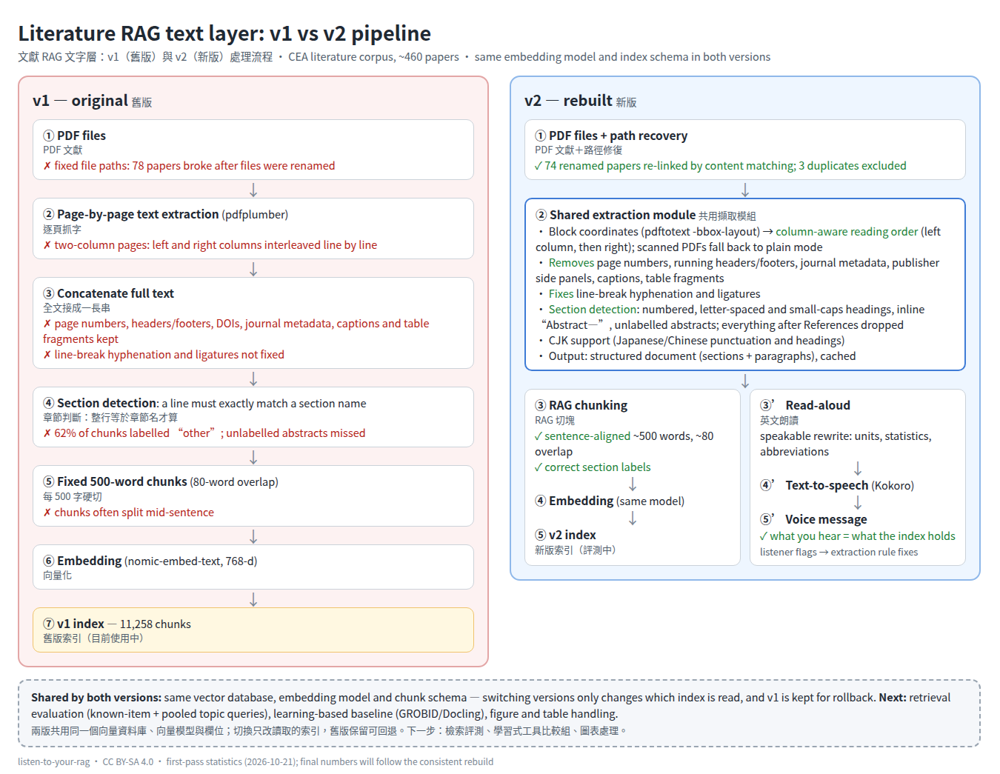

# Method: v1 vs v2 text pipeline / 方法：v1 與 v2 文字處理流程

> Published 2026-10-21. Statistics are from the **first-pass** rebuild; final numbers will be added after a single-version full rebuild ([#2](https://github.com/kylecat/listen-to-your-rag/issues/2)).
> 統計數字為第一輪重建結果；以單一版本完整重建後會更新。

## Context / 背景

A retrieval-augmented generation (RAG) index over ~460 controlled-environment-agriculture papers (plant factories, vapor pressure deficit, lighting, hydroponics, AI agents) serves several research agents. An audit of the original index (v1) found structural problems in the **text layer** — the text that is chunked and embedded — rather than in the embedding model or the retriever.

## v1 — original pipeline / 舊版

1. Page-by-page text extraction with a general PDF library.
2. Pages concatenated into one string.
3. Section detection only when a whole line equals a known section name.
4. Fixed 500-word chunks with 80-word overlap.
5. Embedding with `nomic-embed-text` (768-d).

**Observed problems / 發現的問題**
| Problem | Effect |
|---|---|
| Two-column pages extracted line by line across both columns | Sentences from the left and right columns interleaved |
| Page numbers, running headers/footers, DOIs, journal metadata, captions, table fragments kept | Noise inside chunks |
| Line-break hyphenation and ligatures (fi, fl) not fixed | Broken words |
| Strict section detection | **62%** of chunks labelled `other`; abstracts without a heading missed |
| Fixed-size chunks | Chunks often start or end mid-sentence |
| File paths stored at ingestion | **78** papers pointed to missing files after renaming |

## v2 — rebuilt pipeline / 新版

**One shared extraction module** feeds both the RAG index and a read-aloud tool.

1. **Column-aware reading order** — text blocks with coordinates are reordered: full-width blocks (titles, wide figures) act as separators; within each segment the left column is read before the right. Documents whose layout yields tiny blocks (typical of scans) fall back to plain extraction.
2. **Noise removal** — page numbers, lines repeated across pages (running headers/footers), journal metadata blocks, publisher side panels (“article info”), figure/table captions and table fragments.
3. **Text repair** — line-break hyphenation and ligatures.
4. **Section detection** — numbered headings, letter-spaced (`A B S T R A C T`) and small-caps (`A BSTRACT`) headings, inline labels (`Abstract—`); when no abstract heading exists, the first prose block that is not metadata is taken as the abstract; everything after References / Acknowledgements is dropped.
5. **CJK support** — Japanese/Chinese sentence punctuation (`。`, `．`), character-based length estimates, CJK section headings; English summary chunks are added for Japanese papers and marked as translations.
6. **Chunking** — sentence-aligned chunks of ~500 words with ~80 words of overlap, each with a section label.
7. **Embedding** — same model as v1, so differences come from the text layer only.
8. **Path recovery** — missing files were re-linked by content matching (chunk text from v1 against the first pages of every PDF on disk); exact duplicates were excluded.

The **read-aloud branch** rewrites the same text into speakable form (units, statistics, abbreviations) and synthesises speech, so a listener hears exactly what the index holds; problems noticed while listening are flagged and turned into extraction-rule fixes ([#10](https://github.com/kylecat/listen-to-your-rag/issues/10)).

## First-pass results / 第一輪結果

| Metric | v1 | v2 |
|---|---|---|
| Papers | 464 | 453 extracted · 8 kept from v1 (scans / missing files) · 3 duplicates excluded |
| Chunks | 11,258 | ≈ 10,000 (noise and references removed) |
| Chunks labelled `other` | 62% | 0% (v2-extracted papers) |
| Abstract detected | — | 445 / 453 |
| Papers with missing files | 78 | 4 (74 recovered by content matching) |
| Top-5 papers shared between v1 and v2 (10 test queries) | — | 1.8 / 5 on average |

The low overlap of top-5 results means v2 changes what is retrieved; whether it is **better** is the subject of the evaluation ([#3](https://github.com/kylecat/listen-to-your-rag/issues/3), [#4](https://github.com/kylecat/listen-to-your-rag/issues/4)).

## Limitations / 限制

- Rule-based layout handling; learning-based tools are expected to do better on scientific PDFs; a comparison with them is future work ([#5](https://github.com/kylecat/listen-to-your-rag/issues/5)).
- Figures and tables are currently dropped ([#6](https://github.com/kylecat/listen-to-your-rag/issues/6)–[#8](https://github.com/kylecat/listen-to-your-rag/issues/8)).
- Scans with a scrambled text layer cannot be repaired by reordering.
- Results come from one domain corpus.

See [related-work.md](related-work.md) for prior research.
